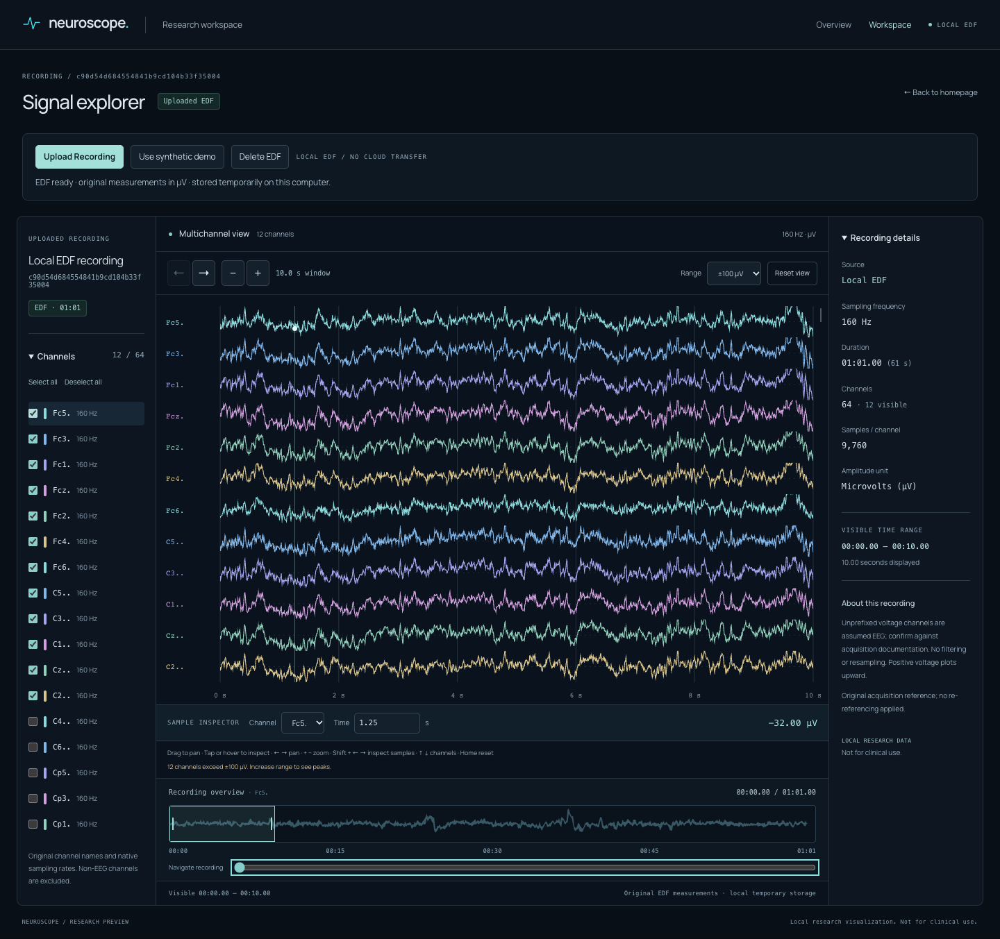
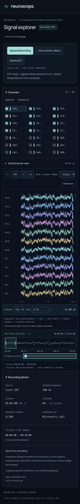

# Phase 3B.2 — local EDF workspace integration

The existing `/app` workspace now opens actual EDF recordings through the local FastAPI/MNE service. The cinematic homepage is unchanged. The deterministic synthetic recording remains available without a backend. No public uploads, deployment, authentication, cloud storage, annotations, or Phase 3B.3 work are included.

## Run locally

From the repository root, in one terminal:

```sh
python3.12 -m venv .venv-backend
.venv-backend/bin/python -m pip install -r backend/requirements.txt
.venv-backend/bin/python -m backend.neuroscope_api
```

If the isolated environment already exists, only the last command is needed. In a second terminal:

```sh
nvm use
npm ci
npm run dev
```

Open **http://127.0.0.1:5173/app**. Select **Upload Recording**, then an `.edf` file. The native dialog sends the selected file as raw bytes to FastAPI; progress reflects actual uploaded bytes, followed by a distinct parsing state. Extension/size checks run in the client; the backend remains authoritative for format, calibration, file size, and resource validation.

Vite proxies `/local-eeg` to `http://127.0.0.1:8000`. The optional `NEUROSCOPE_API_TARGET` in root `.env` can change the loopback backend port; non-loopback targets are rejected. Keep Vite on port 5173 because the backend explicitly allows only the local 5173 frontend origins. Neither permissive CORS nor a remote API URL is used. Production builds disable uploads, and production preview has no EEG proxy.

## Working behavior

- Actual original EEG/candidate channel names, native sampling rates, durations, sample counts, and microvolt measurements.
- First 12 EDF channels selected initially for readability; select any subset, all, or none. Larger selections increase plot height instead of compressing every trace into an unreadable lane.
- Channel visibility, zoom, drag/keyboard pan, timeline navigation, reset, amplitude range, and sample inspection operate on the current recording.
- Switching between channels with different rates retains the inspected time, snapped to the new channel's original sample clock. No resampling, filtering, interpolation, or re-referencing is applied to data.
- Return to the synthetic demo and back to the current EDF. Replacement deletes the previous backend resource after the new source is ready. Delete EDF removes the actual backend resource and restores the demo. Failed deletion is reported rather than pretending it succeeded.
- Missing/expired recordings clear their signals and restore the clearly labeled demo with an explanation. Reads revalidate existence even on cache hits; tab focus also checks the resource. The expiry timer releases the active source.
- A stopped backend produces an understandable error without disabling the synthetic demo. A failed upload preserves the current source.
- Generic recording title; filenames, patient identifiers, acquisition dates, and annotations are not displayed. Original channel names remain visible because they are scientifically necessary.

## Scientific and resource boundaries

The existing raw endpoint supplies **µV already**. The frontend retains float64 EDF values without applying another scale factor. Each channel has its own rate, count, absolute sample offset, and optional original extrema indices. The recording-level navigation grid never becomes a resampling target.

Narrow windows use `/samples`, one selected channel at a time, respecting the backend's advertised window and value limits. Requests contain only needed channels and time intervals (plus the boundary sample used to draw the right edge). Raw client windows are limited to 8,192 values per channel. Remote navigation is coalesced for 80 ms. Requests are serialized to respect the backend's one-operation gate; stale requests are aborted and ignored, with bounded busy retries.

Wide views use the new `/display` endpoint. It scans one native channel in chunks of at most 65,536 samples, returning at most 1,024 min/max bins to this viewer, including the original positions of both extrema. Every source sample belongs to a disjoint bin; spikes are not averaged away. The renderer retains these extrema rather than reducing them a second time. This is an explicitly labeled display envelope, not a modified signal or analytic downsampling operation. Exact inspection retrieves the requested original sample when it is not present among the displayed extrema.

The timeline requests a 600-bin server-side overview of the first available channel. It never downloads the entire recording. A scan has a 10-second deadline; on timeout, the overview reports unavailable while time navigation remains available. The client cache holds at most 128 channel windows (at most roughly 16 MiB of value/index storage), plus the current view and a small overview. Memory does not grow with recording duration. There is no persistent browser recording cache.

Existing backend restrictions remain: default 64 MiB uploads, 256 MiB aggregate temporary storage, four recordings, one-hour TTL, private filesystem permissions, cleanup on deletion/expiry/shutdown, and the documented continuous EDF subset. Limits can be reduced via backend environment variables. See [backend/README.md](backend/README.md).

## Verification

- **50 frontend tests**: existing viewer/homepage tests plus native-rate inspection, API mapping, no duplicate unit conversion, cache revalidation, original extrema positions, exact inspection, expiry, canceled work, and pre-upload validation. The old assertion that uploads must be absent was updated for this explicitly authorized milestone.
- **44 backend tests**, including the public EDF: original scientific calibration tests plus per-channel display extrema, exact sample retrieval, chunk-boundary peaks, bounded scan allocation, invalid display requests, deletion, and explicit local-origin checks.
- TypeScript, ESLint, Prettier, Ruff lint/format, Python dependency consistency, production build, and build-output audit passed. Existing lazy Three.js chunk-size advisory and upstream Starlette/httpx test-client deprecation warning remain.
- Real Chrome browser verification at **1440 × 1000** and **390 × 844**: homepage CTA, native file chooser, raw upload, metadata, channel mapping, µV readout against independent single-channel MNE reads, zoom/pan/timeline, full-duration display, channel toggles, select all/none, rapid navigation, demo switching, replacement, actual deletion/404, corrupted EDF errors, and missing-resource recovery. No mocked API was used in this script.
- Existing synthetic-workspace browser regression passed at 1440, 1180, and 390 px widths; production homepage/workspace regression passed at desktop and mobile sizes.
- Separate browser run with the actual backend stopped verified the connection error and continued synthetic zoom interaction.
- Desktop/mobile screenshots were visually inspected. No horizontal page overflow or browser JavaScript errors were detected.

### Exact public recording

**PhysioNet EEG Motor Movement/Imagery Dataset v1.0.0, S001/S001R01.edf**: 64 channels, 160 Hz, 9,760 samples/channel, 61 seconds, 1,275,936 bytes. Original `Fc5.`-style labels are retained. The browser inspector's Fc5. measurement at 1.25 seconds is **−32.00 µV**, matching an independent MNE read.

Source, author, license (Open Data Commons Attribution License 1.0), citations, and checksum are in [backend/PUBLIC-DATA.md](backend/PUBLIC-DATA.md). Test downloads and generated EDFs remain ignored under `work/backend/`; no EDF file is committed or placed in `public/`.

The generated EDF+C fixture additionally verifies three available channels at **128 / 64 / 128 Hz**, different original V/mV/uV units, and exclusion of its ECG channel. It contains only explicitly fake test identifiers.

### Reproduce browser verification

Download the pinned public file as documented in `backend/PUBLIC-DATA.md`, then run:

```sh
.venv-backend/bin/python -m backend.prepare_browser_fixture
# Start FastAPI and Vite in separate terminals first.
NEUROSCOPE_PLAYWRIGHT=/absolute/path/to/playwright \
  node scripts/verify-edf-workspace.cjs
# Stop FastAPI, leaving Vite running, then verify the offline state:
NEUROSCOPE_PLAYWRIGHT=/absolute/path/to/playwright \
  node scripts/verify-edf-workspace.cjs --offline
```

The helper verifies the public file checksum and creates an independent MNE amplitude oracle. The browser script uses installed Playwright/Chrome (not an added application dependency). `NEUROSCOPE_CHROME` can point to another compatible Chrome executable. Results and temporary screenshots are written to ignored `work/phase-3b2/`. Do not replace the public fixture with private data when producing shared screenshots.

## Screenshots





## Remaining limitations

- Local macOS/Linux development only; no public upload service or security/compliance claim. These tools are not clinically validated.
- One uploaded recording is managed in the current browser session. Reloading or leaving the workspace returns to the demo; abandoned backend files expire automatically or are removed on shutdown. There is no persisted recording library.
- Candidate EEG classification and the supported continuous EDF subset are inherited from Phase 3B.1. No discontinuous EDF, BDF, annotation display, montage editor, or signal-processing controls.
- Wide-view/overview scans can take longer on large files or slow hardware and may hit the bounded deadline. The browser displays an error rather than substituting synthetic values.
- No drag-and-drop in this milestone; use the accessible native file chooser.
- No mobile-device performance claim beyond the tested Chrome mobile viewport and touch emulation.

Phase 3B.2 stops at this integration. Phase 3B.3 and deployment remain pending approval.
